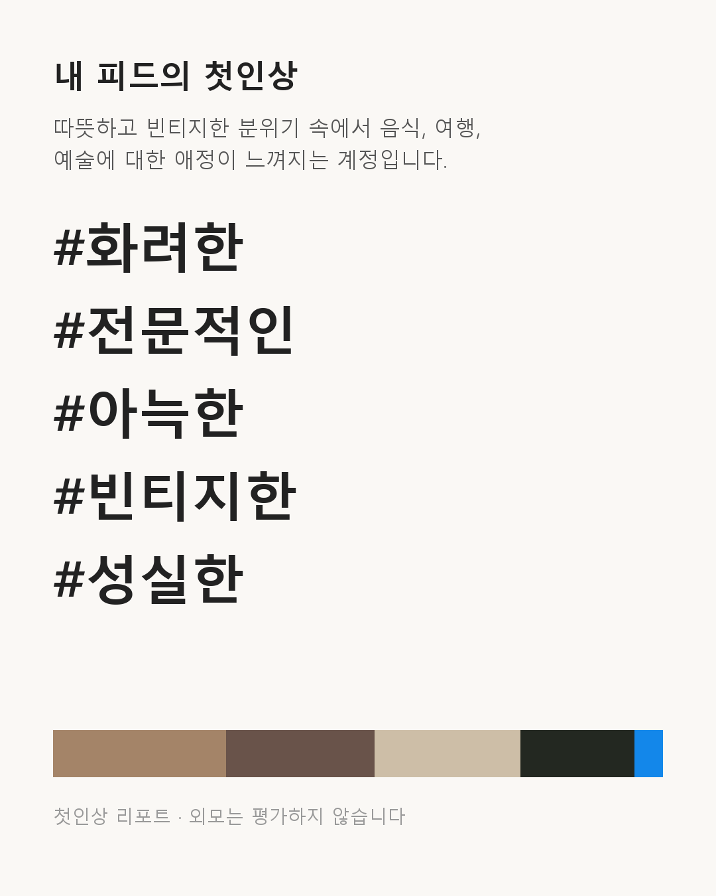

# 첫인상 리포트

인스타그램 피드 캡처(9장)와 소개글을 넣으면, 처음 본 사람이 받을 첫인상 키워드 5개와 근거 사진, 바로 고칠 수 있는 개선안 3개(대표 이미지·색감·소개글)를 돌려주는 퍼스널 브랜딩 진단 도구입니다. 외모는 평가하지 않고 사진의 색감·구도·주제·분위기와 글의 톤만 봅니다.

LLM 수업(순천향대 AI빅데이터학과, 2026-2학기) 프로젝트입니다.



## 파이프라인

키워드는 CLIP이 고르고, LLM은 고른 이유를 설명만 합니다.

| 단계 | 하는 일 | 모델·기법 | 수업 |
|---|---|---|---|
| 0 전처리 | 그리드 캡처를 9칸으로 나누고 EXIF 제거 | PIL | - |
| A 색감 | 팔레트, 밝기·채도, 톤 통일감, 튀는 사진 | KMeans, HSV, 히스토그램 교집합 | - |
| B 키워드·주제 | 키워드 30개(분위기 15 + 성향 15)·주제 12개 zero-shot | CLIP ViT-B/32, 프롬프트 앙상블 | 9장 |
| C 캡션 | 사진마다 한 줄 설명 | BLIP-2 opt-2.7b (8bit) | 9장 |
| D 소개글 톤 | 감성·전문적·친근 등 톤 분류, 직무 키워드·링크 | bge-m3 임베딩 zero-shot | 2·8장 |
| E 가이드 검색 | 가이드 카드 12장에서 영역별 2장 | bge-m3 + BM25 하이브리드(RRF) | 8장 |
| F 리포트 생성 | 요약·키워드 이유·개선안 JSON | EXAONE-3.5-7.8B (4bit NF4), ICL 2개 | 6·7장 |
| V 검증 | JSON·금지어·키워드·사진 번호·출처 확인, 실패 시 규칙 기반 리포트 | 규칙 | - |

자세한 설계는 [기획서.md](기획서.md), [파이프라인.md](파이프라인.md)에 있습니다.

## 실행

[첫인상_리포트.ipynb](첫인상_리포트.ipynb) 하나에 전체 파이프라인이 들어 있습니다. 위에서부터 차례로 실행하면 `outputs/keyword_card.png`와 `outputs/report.json`이 만들어집니다.

- 입력: `samples/01~09.jpg`와 노트북 상단의 `BIO`. 내 사진으로 바꾸려면 `samples/`의 파일을 교체합니다.
- `USE_CAPTION = False`로 두면 BLIP-2 단계를 건너뜁니다(VRAM·시간 절약).
- 확인한 환경: Windows 11, Python 3.13, RTX 5050 Laptop 8GB, torch 2.7.1+cu128, transformers 5.16.1, bitsandbytes 0.50.2, sentence-transformers 6.0.1, scikit-learn 1.6.1, rank-bm25 0.2.2
- 8GB GPU 한 장에서 돌도록 큰 모델은 하나씩 올리고 내립니다. 전체 실행 약 2.5분(모델 다운로드 제외).

```bash
pip install torch --index-url https://download.pytorch.org/whl/cu128
pip install "transformers>=5" bitsandbytes accelerate sentence-transformers scikit-learn rank-bm25 pillow matplotlib pandas
```

### 8GB GPU에서 겪은 문제

- **EXAONE-3.5 + transformers 5:** 원격 코드의 `create_causal_mask` 인자 이름이 바뀌어 노트북에서 호환 패치를 적용합니다. `dtype=torch.bfloat16`을 명시해야 4bit 모델이 GPU에 다 올라갑니다.
- **긴 프롬프트에서 생성이 멈추거나 CUBLAS 오류:** transformers가 SDPA를 `enable_gqa=True`로 부르면 이 GPU에서는 메모리 효율 커널 대신 n×n 행렬을 만드는 경로로 빠집니다. 캡션을 넣은 약 3000토큰 프롬프트에서 VRAM을 넘깁니다. `use_gqa_in_sdpa`를 끄면 prefill 최고 메모리가 3.2GB → 0.8GB로 줄고 생성도 158초 → 51초로 빨라집니다.

## 예시 결과 (샘플 피드)

| 항목 | 결과 |
|---|---|
| 첫인상 키워드 | 화려한 · 전문적인 · 아늑한 · 빈티지한 · 성실한 |
| 색감 | 톤 통일감 0.27(사진마다 톤이 다르다), 가장 튀는 사진 4번 |
| 소개글 톤 | 감성 (직무 키워드 없음) |
| 개선안 | 대표 이미지: 사진 2·7번을 첫 화면에 / 색감: 필터 하나로 통일, 4·8번 보정 / 소개글: 한 줄 자기소개 추가 |

전체 출력은 [outputs/report.json](outputs/report.json)에 있습니다.

## 샘플 사진 출처

`samples/`의 사진 9장은 위키미디어 공용의 CC BY / CC BY-SA / 퍼블릭 도메인 이미지입니다. 저작자·라이선스·원본 링크는 [samples/credits.csv](samples/credits.csv)에 있습니다. 가이드 카드 12장은 직접 쓴 초안입니다.
